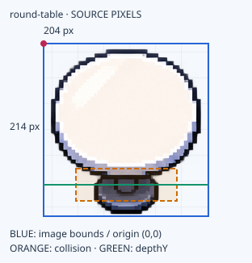
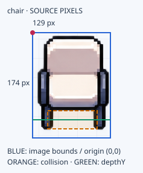
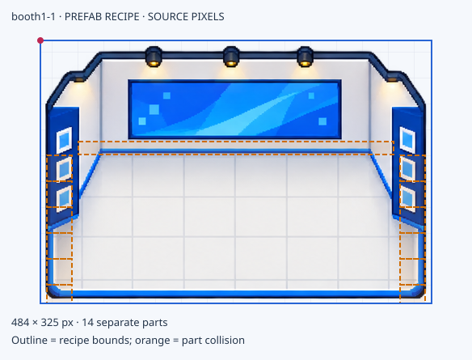

# Asset Catalog ตัวอย่าง

Profile: **Editor32-v1** · ตรวจข้อมูลต้นทางวันที่ **2026-10-11** · 1 tile = **32 world pixels**

เริ่มดูภาพและการเทียบสัดส่วนที่ [Catalog.html](Catalog.html) แล้วใช้เอกสารนี้เป็นตัวอย่างข้อมูลกำกับ asset อ่านร่วมกับ [MapStandard.md](../MapStandard.md), [ObjectAssetGuide.md](../ObjectAssetGuide.md) และ [CharacterAssetGuide.md](../CharacterAssetGuide.md)

ตัวอย่างนี้คัดลอกภาพเดิมเพื่อทำเอกสาร ไม่ได้สร้าง artwork ใหม่ เปลี่ยนแมป หรือปรับ config ของเกม รูปและค่ามาจากไฟล์ใน POC-Phaser/Editor ไม่ได้อ่านแมปฉบับล่าสุดในฐานข้อมูล

## วิธีอ่าน

- **Source pixels** คือพิกเซลในภาพต้นฉบับ และพิกัด collision/depth ภายในภาพ
- **World pixels** คือขนาดและระยะในเกมหลังปรับ scale; หาร 32 เพื่อแสดงเป็น tile
- **Image/frame bounds** รวมพื้นที่โปร่งใสและส่วนบนของภาพ ไม่ใช่ฐานบนพื้นทั้งหมด
- **Collision** คือพื้นที่ชนที่นิยามไว้ ไม่ควรใช้แทน footprint สำหรับจองพื้นที่ใน blueprint โดยอัตโนมัติ
- **Blueprint footprint** ต้องกำหนดแยกเมื่อไม่มีข้อมูลที่รับรอง กรอก unresolved ได้ ไม่ปั้นตัวเลขให้ดูแม่น
- สีฟ้าในภาพกำกับ = กรอบภาพ, ส้มเส้นประ = collision, เขียว = depth/แนวเท้า, แดง = origin/anchor
- assetId เช่น `round-table` เป็นชื่อแบบ ส่วน instanceId เช่น `T01` ระบุของแต่ละชิ้นบน blueprint และ object.id เป็นรหัสเชิงตัวเลขใน TMJ

## สถานะ

ค่าที่ระบุว่า source-checked ตรวจจาก TSJ/TMJ/config และขนาด PNG แล้ว ตัวอย่างนี้ **ยังไม่ได้ทดสอบ runtime หรืออนุมัติ artwork ใหม่** การมีภาพและ collider ไม่ได้ยืนยัน interaction, path accessibility หรือการบังหน้าหลังในทุกตำแหน่ง

## รายการ

| Asset ID | ประเภท | สถานะ | Blueprint footprint |
|---|---|---|---|
| round-table | สิ่งของภาพเดียว | source-checked | unresolved |
| chair | สิ่งของภาพเดียว | source-checked | unresolved |
| booth1-1 | prefab หลายชิ้น | source-checked | unresolved |
| kaguya | ตัวละคร 24 เฟรม | source-checked | ใช้ anchor/body ตามเกม ไม่ใช้กรอบเฟรมเป็นฐาน |

## round-table

ภาพต้นฉบับ: [PNG](images/round-table.png)

| ข้อมูล | ค่า |
|---|---|
| Asset ID | round-table |
| ไฟล์ภาพ | images/round-table.png |
| ขนาดภาพต้นฉบับ | 204 × 214 source px |
| ขนาดแสดงใน seed TMJ | 122.4 × 128.4 world px |
| กรอบภาพแสดงคิดเป็น tile | 3.825 × 4.0125 tile |
| Scale X/Y | 0.6 × 0.6 |
| Blueprint footprint | unresolved; ยังไม่เท่ากับกรอบภาพหรือ collision |
| Origin | มุมซ้ายบนกรอบภาพ (0,0) |
| Collision local | x=40, y=155, w=125, h=40 source px |
| Collision หลัง scale | offset=(24,93), size=75 × 24 world px |
| Collision คิดเป็น tile | 2.3438 × 0.75 tile |
| Depth | depthY=175 source px; depth โลก = object.y + depthY × scaleY |
| Interaction | ไม่มี handler เฉพาะสิ่งของนี้ที่ตรวจในตัวอย่าง; ต้องกำหนดตอนวางและรองรับในเกม |
| Facing / variants | unresolved; ให้เลือกและตรวจ reference ก่อนใช้เป็นกติกา |
| Source | exhibition.tsj tile.id=4; seed TMJ object.id=333 |
| Status | source-checked; runtime not checked in this example |

## chair

ภาพต้นฉบับ: [PNG](images/chair.png)

| ข้อมูล | ค่า |
|---|---|
| Asset ID | chair |
| ไฟล์ภาพ | images/chair.png |
| ขนาดภาพต้นฉบับ | 129 × 174 source px |
| ขนาดแสดงใน seed TMJ | 83.85 × 113.1 world px |
| กรอบภาพแสดงคิดเป็น tile | 2.6203 × 3.5344 tile |
| Scale X/Y | 0.65 × 0.65 |
| Blueprint footprint | unresolved; ยังไม่เท่ากับกรอบภาพหรือ collision |
| Origin | มุมซ้ายบนกรอบภาพ (0,0) |
| Collision local | x=25, y=129, w=82, h=30 source px |
| Collision หลัง scale | offset=(16.25,83.85), size=53.3 × 19.5 world px |
| Collision คิดเป็น tile | 1.6656 × 0.6094 tile |
| Depth | depthY=144 source px; depth โลก = object.y + depthY × scaleY |
| Interaction | ไม่มี handler เฉพาะสิ่งของนี้ที่ตรวจในตัวอย่าง; ต้องกำหนดตอนวางและรองรับในเกม |
| Facing / variants | unresolved; ให้เลือกและตรวจ reference ก่อนใช้เป็นกติกา |
| Source | exhibition.tsj tile.id=5; seed TMJ object.id=334 |
| Status | source-checked; runtime not checked in this example |

## booth1-1: prefab บูธหลายชิ้น

ภาพนี้ประกอบเพื่อดูเอกสารจาก recipe ไม่ใช่ PNG ใหม่สำหรับแทน prefab ในเกม เส้นสีส้มเป็น collision ของแต่ละชิ้น; depth ยังคงกำหนดรายชิ้นใน TSJ

| ข้อมูล | ค่า |
|---|---|
| Asset ID / prefab key | booth1-1 |
| ขอบเขต recipe | 484 × 325 source px |
| จำนวนชิ้น | 14 |
| ขอบเขตแสดงตาม scale ชิ้นใน seed | 300.08 × 201.5 world px |
| ขอบเขตภาพคิดเป็น tile | 9.3775 × 6.2969 tile |
| Blueprint footprint | unresolved; recipe bounds รวมภาพส่วนบน ไม่ใช่ฐานที่รับรอง |
| Origin ของ recipe | มุมซ้ายบนกรอบ recipe |
| Collision / depth | อ่านจาก TSJ ของแต่ละ part แล้วแปลงด้วยตำแหน่งและ scale |
| การย้าย | ย้าย group; เก็บตำแหน่งย่อยสัมพันธ์กับ group |
| NPC / interact | ไม่ได้เพิ่ม NPC ให้ทุก prefab อัตโนมัติ ต้องกำหนดและตรวจ handler |
| Source | assets/booth-parts.json + exhibition.tsj + seed TMJ |

| Part key | Local X,Y | W×H source px |
|---|---|---|
| booth1-1-back | 0, 0 | 484 × 142 |
| booth1-1-floor | 47, 142 | 390 × 183 |
| booth1-1-left-0 | 0, 142 | 47 × 32 |
| booth1-1-right-0 | 437, 142 | 47 × 32 |
| booth1-1-left-32 | 0, 174 | 47 × 32 |
| booth1-1-right-32 | 437, 174 | 47 × 32 |
| booth1-1-left-64 | 0, 206 | 47 × 32 |
| booth1-1-right-64 | 437, 206 | 47 × 32 |
| booth1-1-left-96 | 0, 238 | 47 × 32 |
| booth1-1-right-96 | 437, 238 | 47 × 32 |
| booth1-1-left-128 | 0, 270 | 47 × 32 |
| booth1-1-right-128 | 437, 270 | 47 × 32 |
| booth1-1-left-160 | 0, 302 | 47 × 23 |
| booth1-1-right-160 | 437, 302 | 47 × 23 |

## kaguya: ตัวละครและ animation

| ข้อมูล | ค่า |
|---|---|
| Character ID | kaguya |
| ภาพ | images/kaguya-walk.png |
| Spritesheet | 1728 × 1024 source px; 6 columns × 4 rows |
| Frame | 288 × 256 source px รวม padding |
| Scale | 0.4 |
| กรอบเฟรมบนโลก | 115.2 × 102.4 world px; 3.6 × 3.2 tile |
| Visible body height | unresolved; ไม่ใช้ frameHeight แทนความสูงตัวคน |
| Feet anchor | (144, 240) source px; entity x/y ใช้อ้างจุดนี้ |
| Physics body | 64 × 30 source px; offset (112,210) |
| Physics body บนโลก | 25.6 × 12 world px |
| Frame rate | 6 animation frames/second |
| Movement speed | 235 world px/second; คนละค่ากับ frame rate |
| Depth | entity.y ที่อ้างใกล้เท้า |
| Blueprint placement | Player ใช้ Spawn; NPC ใช้ Npc contract ที่เกมรองรับ |
| Status | geometry source-checked; ไม่ได้ทดสอบ loop หรือ artwork approval ในรอบนี้ |

| ทิศ | เฟรมเดิน | Idle |
|---|---|---|
| up | 0–5 | 0 |
| down | 6–11 | 6 |
| left | 12–17 | 12 |
| right | 18–23 | 18 |

### Sheet พร้อมเลขเฟรม

ดูภาพพร้อมเลขเฟรมและปุ่มเล่นตัวอย่างใน [Catalog.html](Catalog.html#character) ภาพต้นฉบับ: [kaguya-walk.png](images/kaguya-walk.png)

การใส่รูปตัวละครเป็น object ธรรมดาใน TMJ ไม่ได้สร้าง Player หรือ NPC และ catalog นี้ไม่ได้ทำให้เกมรับ character ใหม่ได้ทันที

## ตัวอย่างการอ้างจาก blueprint

| Instance ID บน blueprint | Asset ID | ตำแหน่ง | ขนาดแสดง | ฐาน/slot |
|---|---|---|---|---|
| T01 | round-table | ใช้ X,Y ของกรอบภาพตาม origin ของ Editor หรือแปลงจากฐานก่อน | ใช้ preset ที่อนุมัติ | unresolved จนกำหนดฐาน |
| T02 | round-table | อีกตำแหน่งหนึ่ง | preset เดียวกัน | ฐานเดียวกัน |
| C01 | chair | แยกจากตำแหน่งโต๊ะ | preset เก้าอี้ | unresolved |
| B01 | booth1-1 | ตำแหน่ง group | recipe/preset | unresolved |
| S01 | Spawn | จุดเท้าของ Player ในโลก | point | ตรวจ body ไม่ทับ collider |

ตารางนี้อธิบายการอ้างอิง ไม่ใช่แมปพร้อมใช้ ยังไม่มี TMJ ใหม่ ถ้า blueprint ระบุ X,Y ของฐาน แต่ runtime ใช้มุมซ้ายบนภาพ ต้องกำหนด footprint offset และแปลงพิกัดก่อนประกอบแมป

## ก่อนอนุมัติ asset ใหม่

- [ ] กำหนด footprint พร้อม offset จากมุมภาพ และขนาดใน world pixels/tile
- [ ] กำหนด default display size หรือ uniform scale โดยไม่ยืดเฉพาะแกน
- [ ] ยืนยัน reference role, กล้อง, สไตล์, ทิศแสงและขนาดสัมพันธ์กับตัวละคร
- [ ] ตรวจ alpha, padding, ขอบภาพ และรอยต่อของชิ้นที่ต่อซ้ำ
- [ ] ตรวจ collision, depth, spawn clearance และทางเดินในเกม
- [ ] ถ้ามี interaction ต้องมี handler และระยะที่เกมอ่านได้จริง
- [ ] ตัวละครต้องตรวจเฟรม ทิศ idle anchor และ loop ในเกม
- [ ] เก็บสถานะ visual-approved และ runtime-validated แยกกัน พร้อมหลักฐาน

## แหล่งข้อมูลและการสร้างใหม่

อ่านภาพและค่าจาก `POC-Phaser/Editor/maps/tilesets/exhibition.tsj`, `maps/exhibition.tmj`, `assets/booth-parts.json` และ `src/game/config.ts` ค่าขนาด seed เป็นตัวอย่างจากไฟล์ ไม่ใช่สถานะล่าสุดในฐานข้อมูล

`build_catalog.py` สร้างเอกสารและภาพกำกับด้วยพิกัดจาก source เขียนเฉพาะในโฟลเดอร์นี้ ภาพ PNG ใน images เป็นสำเนาเดิม ภาพ SVG เป็นแผนภาพเอกสารที่มี annotation ไม่ใช่ asset ใหม่สำหรับเกม การสร้างใหม่จะเขียนทับไฟล์ตัวอย่างในโฟลเดอร์นี้
