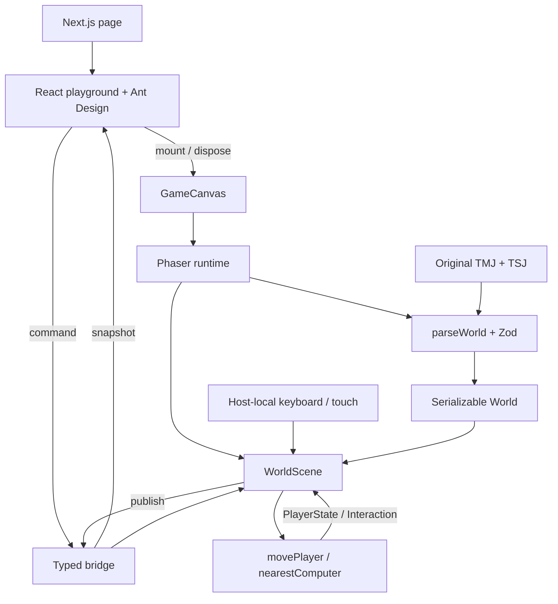

# สถาปัตยกรรมของ Sample

หลักที่เลือกคือให้คนอ่านตอบได้ว่า "ถ้าพฤติกรรมนี้เปลี่ยน ต้องแก้ที่ไหน" โครงสร้างตาม feature สำหรับ UI และแยกงานที่มีเหตุผลในการเปลี่ยนต่างกันในเกม

## Framework และ engine ที่ใช้

Sample ใช้ Next.js 16.4.0 App Router เป็น framework ของเว็บ และ Phaser 4.2.1 เป็น engine วาดเกมใน browser โดยล็อกรุ่นใน package.json และ package-lock.json

`src/app/page.tsx` และ `layout.tsx` เป็น entry ของ Next.js ส่วน Playground เป็น Client Component ที่ใช้ AntD `GameCanvas` โหลดผ่าน `next/dynamic` พร้อม `ssr: false` และ import runtime ใน useEffect จึงไม่โหลด Phaser บน server

ย้ายจาก Phaser 3.90.0 เป็น 4.2.1 โดยใช้ Scene, Sprite, Graphics, animation และ camera API เดิมที่ Sample ต้องการ ไม่มี custom WebGL pipeline ที่ต้องเขียนใหม่ กำหนด `render.roundPixels: true` และ `antialias: false` เองเพื่อรักษาการแสดง pixel art ไม่อาศัยค่าเริ่มต้นของ engine

World, กติกา movement/interaction, typed bridge และ map parser ใช้โครงสร้างเดิม การเปลี่ยน renderer จึงไม่ต้องเขียนกติกาเกมใหม่ Browser tests ตรวจ `data-phaser-version` ที่ runtime ใส่จาก `Phaser.VERSION` เพื่อยืนยันว่าโหลด v4 จริง

อ้างอิง [migration guide ทางการ](https://phaser.io/news/2026/04/migrating-from-phaser-3-to-phaser-4-what-you-need-to-know)

## แผนภาพ



ลูกศรในรูปแสดง flow ไม่ใช่ทุกเส้นเป็น import ตัว `bridge.ts` และ `domain/` ไม่มี import จาก React หรือ Phaser

## ใครเป็นเจ้าของอะไร

| Module                     | เจ้าของข้อมูล/พฤติกรรม                                      | สิ่งที่ไม่ควรใส่ในนี้                |
| -------------------------- | ----------------------------------------------------------- | ------------------------------------ |
| `app/`                     | Route, metadata, registry ของ AntD, CSS tokens              | กติกาการเดิน                         |
| `features/playground/`     | หน้าเว็บ, loading/error, drawer, ปุ่มและ state ของแผงคอม    | Sprite หรือการตรวจชน                 |
| `game/bridge.ts`           | Interface ส่ง command และ snapshot ของเกมหนึ่ง instance     | Singleton โลก, rules, Phaser objects |
| `game/domain/`             | ชนิด World/Player, movement, collision และระยะ E            | DOM, network, React, Phaser          |
| `game/tiled/parseWorld.ts` | ตรวจ JSON และแปลง editor export เป็น World                  | เปิด Modal หรือเลือกธุรกิจของบูธ     |
| `game/phaser/`             | โหลดภาพ, วาดภาพ, animation, camera, input และ orchestration | State ของฟอร์ม React                 |

ข้อมูลตำแหน่งจริงเป็น `PlayerState` ใน runtime ตัว sprite แสดงตามตำแหน่งนี้ และไม่ใช่แหล่งข้อมูลหลัก UI รับ snapshot ซึ่งอาจช้ากว่า simulation สูงสุดประมาณ 100 ms เพื่อไม่ให้ React render ทุก frame

World เป็นข้อมูลที่ serialize ได้ แต่ Sample ยังไม่ได้ทำ persistence, save schema หรือ server synchronization การใช้ `Phaser.Game` หรือ sprite เป็น save state จะผูกข้อมูลไว้กับ renderer มากเกินไป

## Seam ระหว่างหน้าเว็บกับเกม

React ต้องเรียนรู้ interface ของ bridge เพียง command, snapshot และ subscription ตัว bridge ไม่เปิดเผย Phaser.Scene หรือ Sprite ให้ React จัดการ

```ts
bridge.dispatch({ type: 'interact' });
bridge.dispatch({ type: 'reset' });
bridge.dispatch({ type: 'pause', paused: true });
```

เกมส่ง snapshot เมื่อ state ที่ UI สนใจเปลี่ยน

```ts
bridge.publish({
  status: 'ready',
  player,
  nearby,
  active,
  debug,
  paused,
  computerCount,
  colliderCount,
});
```

`Snapshot` แยกเป็น loading, error และ ready ด้วย discriminated union จึงไม่บังคับให้ UI อ่าน player ก่อนโหลดเสร็จ `Command` ใช้ union เช่นกัน ถ้าเพิ่ม command แล้วลืม handle ใน Scene ตัว `never` จะทำให้ TypeScript แจ้งข้อผิดพลาด

ไม่มี event bus แบบ string ทั่วแอป และไม่มี global store สำหรับตำแหน่งทุก frame หนึ่ง Playground สร้าง bridge ของตัวเองด้วย `useState(createGameBridge)`

## ตั้งแต่เปิดหน้าไปจนเดินได้

1. `app/page.tsx` แสดง Playground ซึ่งเป็น Client Component
2. `GameCanvas` อยู่ใน `next/dynamic` ที่ปิด SSR
3. `useEffect` รอ DOM แล้ว import runtime ฝั่ง browser
4. `mountGame` fetch TMJ/TSJ พร้อมกันและผ่าน `parseWorld`
5. Phaser เรียก `preload` เพื่อโหลดภาพที่ระบุใน World และ manifest
6. `create` สร้างพื้น วัตถุ ตัวละคร และ input controller
7. `update` อ่าน input เรียก domain แล้ววาด PlayerState ใหม่
8. bridge ส่ง snapshot ให้ React ผ่าน `useSyncExternalStore`

การ import Phaser อยู่ใน browser เพราะ Phaser อ้างถึง `window` ระหว่างโหลด module การใส่ `'use client'` เพียงอย่างเดียวไม่ได้หมายความว่า framework จะไม่ prerender เลย

## ทำไม movement ไม่ใช้ Arcade Physics

POC นี้ต้องการให้เรียนรู้กติกาโดยอ่าน function เดียว จึงใช้กรอบเท้า AABB ตรวจกรอบ collision จากแมป การเดินทแยง normalize vector และแบ่งระยะเป็นก้าวเล็กไม่เกิน 4px เพื่อไม่ข้าม collider บาง ๆ

ข้อดีคือทดสอบโดยใช้ Node ได้ ไม่ต้องสร้าง Scene และเห็น calculation ทั้งหมด ข้อแลกเปลี่ยนคือยังไม่มี rigid-body physics, dynamic body collision, acceleration หรือการชนรูป polygon ถ้างานจริงต้องการพฤติกรรมเหล่านี้ให้เลือก Arcade/Matter และกำหนดเจ้าของ state ใหม่ อย่าใส่ระบบ physics สองชุดที่ต่างคนต่างอัปเดตตำแหน่ง

Domain มี pure functions แต่ WorldScene ยังเป็นผู้เรียกและเก็บ session state สำหรับ POC ยังไม่ได้แยกเป็น simulation engine เต็มตัว เมื่อเพิ่ม multiplayer หรือ replay จึงค่อยแยก GameSession ที่มี update/command interface ชัดเจน

## Lifecycle และ input

- React unmount จะ abort fetch และ `destroy(true)` เพื่อถอน canvas
- ถ้า async mount เสร็จหลัง cleanup จะ dispose เกมนั้นทันที
- Scene shutdown ยกเลิก bridge handler และ listeners ที่ attach ไว้
- Keyboard ฟังเฉพาะ host ที่ focus ปุ่มใน AntD จึงไม่กลายเป็น input ของเกม
- blur, window blur และ visibility change ล้างปุ่มค้าง
- เมื่อเปิด Modal/คู่มือ เกมหยุดเดินและล้าง input
- การเปิดคู่มือระหว่างโหลดจำ pause ไว้ แล้ว replay เมื่อ runtime พร้อม
- Touch controls ใช้ pointer capture และล้างทิศทางตอน release/cancel

## เลือก UI แบบไหน

แมปเป็นพื้นที่หลัก แผงด้านข้างมีภารกิจสั้นและสถานะที่ช่วยทดลอง ป้ายในแมปแสดงเท่าที่จำเป็น คู่มืออยู่ใน Drawer เพื่อไม่ปิดบังโลกตลอดเวลา

Palette มีพื้นเว็บ `#f5f8f7`, ตัวอักษร `#253e40`, accent `#167c70`, แผง `#e9f3ee` และเส้น `#dce6e2` อิงสีห้องที่ให้มา ใช้ Noto Sans Thai เมื่อเครื่องมี แล้ว fallback ไป Leelawadee UI/Segoe UI โดยไม่บังคับโหลดฟอนต์ภายนอก

Tailwind ดูแล utility เช่น max-width ของ layout ส่วน CSS ดูแล tokens และองค์ประกอบเฉพาะหน้า Ant Design ดูแล Button, Switch, Modal, Drawer และ Segmented ผ่าน ConfigProvider ไม่เอา styles ของทั้งสองระบบมาคุม property เดียวกันซ้ำ ๆ

## เปลี่ยนงานแล้วแก้ที่ไหน

| สิ่งที่ต้องการเปลี่ยน | ไฟล์เริ่มต้น                                              |
| --------------------- | --------------------------------------------------------- |
| ความเร็ว/ขนาดกรอบเท้า | `game/domain/world.ts`                                    |
| กติกาชนและเดิน        | `game/domain/movement.ts`                                 |
| ระยะเปิดคอม           | `game/domain/interaction.ts` และ world constant           |
| ปุ่มควบคุม            | `game/phaser/input.ts`                                    |
| Sprite/animation      | `game/phaser/manifest.ts` และ `WorldScene.ts`             |
| พิกัด/metadata export | `game/tiled/parseWorld.ts`                                |
| เนื้อหาแผงคอม         | `features/playground/Playground.tsx`                      |
| รูปแบบหน้าเว็บ        | `app/globals.css`                                         |
| เพิ่ม command ใหม่    | `game/bridge.ts` และ exhaustive switch ใน `WorldScene.ts` |

ยังไม่เพิ่ม ECS, generic repository, DI container หรือ base class หลายชั้น เพราะยังไม่มีความต้องการที่ทำให้สิ่งเหล่านี้ลดภาระคนอ่าน การดูแลระยะยาวต้องอาศัย tests, contract ของ assets และเอกสารที่อัปเดตตามโค้ดด้วย ไม่ใช่แค่จำนวนโฟลเดอร์

## เอกสารอ้างอิง

- [Next.js lazy loading](https://nextjs.org/docs/app/guides/lazy-loading)
- [Ant Design with Next.js](https://ant.design/docs/react/use-with-next/)
- [Phaser Scene](https://docs.phaser.io/api-documentation/class/scene)

รายละเอียดในเอกสารนี้อธิบาย implementation ที่ตรวจจาก Sample ไม่ได้อ้างว่าเป็นสถาปัตยกรรมสำหรับทุกประเภทเกม
